<div align="center">



<br />

[](https://js-package.xyz)
[](mailto:js@yustellar.dev)


<sub><code>&gt;_ 一座漂浮在 Web 星系裡的 JavaScript / TypeScript 套件倉庫 —— AI、即時通訊、遊戲引擎、音訊合成，全部在同一條軌道上運行。</code></sub>

</div>


## 🛰️ BOOT SEQUENCE

```text
[ 0.000 ] JS-PACKAGE.XYZ :: cold boot initiated
[ 0.042 ] mounting sector 0x01 INTELLIGENCE ......... Neko.js · WebChatMCP.js · Gauge.js
[ 0.117 ] mounting sector 0x02 SIMULATION ........... XYZ.js · Beacon.js
[ 0.203 ] mounting sector 0x03 SIGNAL ............... Stage.js · OPM.js · LINE.js
[ 0.288 ] mounting sector 0x04 TESTBED .............. demos
[ 0.300 ] uplink -> https://js-package.xyz .......... [ OK ]
[ 0.301 ] all systems nominal. welcome aboard, pilot.
```

## 🌌 STAR MAP

### `0x01` INTELLIGENCE — 智能核心

| MODULE | CORE | TRANSMISSION | PORTAL |
| :-- | :-: | :-- | :-: |
| 🟢&nbsp;**[Neko.js](https://github.com/JS-PACKAGE/Neko.js)** | `TS` | 本機多模態推論 SDK：在 Node.js 與 WebGPU 瀏覽器上跑文字／影像推論、PDF 擷取、OCR 與文件查詢，Qwen × ONNX 驅動。 | [⟶](http://neko.js-package.xyz/) |
| 🟢&nbsp;**[WebChatMCP.js](https://github.com/JS-PACKAGE/WebChatMCP.js)** | `JS` | 內建瀏覽器的 MCP server，經 ChatGPT／Claude／Grok／Gemini 的臨時對話送出 prompt，不留聊天紀錄，支援訪客模式。 | [⟶](https://webchatmcp.js-package.xyz) |
| 🟢&nbsp;**[Gauge.js](https://github.com/JS-PACKAGE/Gauge.js)** | `TS` | 自架 AI 訂閱額度儀表板（Antigravity、Codex、Claude、Grok），PWA + Web Push 警報，零 runtime 依賴。 | [⟶](http://gauge.js-package.xyz/) |

### `0x02` SIMULATION — 模擬引擎

| MODULE | CORE | TRANSMISSION | PORTAL |
| :-- | :-: | :-- | :-: |
| 🟣&nbsp;**[XYZ.js](https://github.com/JS-PACKAGE/XYZ.js)** | `TS` | The Final Web Game Engine. | [⟶](http://xyz.js-package.xyz/) |
| 🟣&nbsp;**[Beacon.js](https://github.com/JS-PACKAGE/Beacon.js)** | `TS` | WSS + OAuth 遊戲分區大廳：持久房間、隊伍、配對、聊天與管理介面，可選 etcd quorum 跨主機 HA。 | [⟶](http://beacon.js-package.xyz/) |

### `0x03` SIGNAL — 訊號與音訊

| MODULE | CORE | TRANSMISSION | PORTAL |
| :-- | :-: | :-- | :-: |
| 🔵&nbsp;**[Stage.js](https://github.com/JS-PACKAGE/Stage.js)** | `TS` | 多人音訊舞台：WebSocket 控制平面 × WebRTC 音訊平面，伺服器端混音成單一 Opus 串流。 | — |
| 🔵&nbsp;**[OPM.js](https://github.com/JS-PACKAGE/OPM.js)** | `TS` | 4-op FM 合成引擎，向 Yamaha YM2151 致敬。 | [⟶](http://opm.js-package.xyz/) |
| 🔵&nbsp;**[LINE.js](https://github.com/JS-PACKAGE/LINE.js)** | `TS` | 本機 TypeScript LINE 網頁客戶端，WebSocket 即時同步頻道與訊息。 | [⟶](http://line.js-package.xyz/) |

### `0x04` TESTBED — 試驗場

| MODULE | CORE | TRANSMISSION | PORTAL |
| :-- | :-: | :-- | :-: |
| 🟡&nbsp;**[demos](https://github.com/JS-PACKAGE/demos)** | `TS` | 各模組的示範與實驗場。 | [⟶](http://demos.js-package.xyz/) |

## 📡 OPEN CHANNEL

> [!TIP]
> 發現異常訊號？歡迎到各模組的 Issues 回報，或直接 PR 加入航線。


<div align="center">
<sub><code>// END OF TRANSMISSION ▪ JS-PACKAGE.XYZ ▪ THE JS PACKAGE STORAGE</code></sub>
</div>
